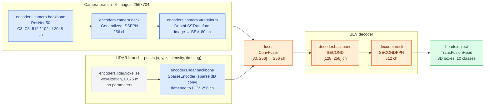

# BEVFusion Training: Work Split

Nov 4, 2026 · @Shourrya

This document divides the nuScenes training exercise into three sub-tasks. It defines the scope of each sub-task, the interfaces between them, and the criteria for completion. Script contents and background on the full training recipe are in **[BEVFusion nuScenes Training Exercise: Pipeline and Code](./BEVFusion%20nuScenes%20Training%20Exercise%20Pipeline%20and%20Code.md)**. Where the two documents differ, this one takes precedence on scope and code location.

> [!WARNING]
> **TODO: pin `wato-cuda-bevfusion` to a commit before trusting any result.**
> For now, both the training image (`training/docker/Dockerfile`) and the perception image (`docker/perception.Dockerfile`) clone the **latest `main`** of `wato-cuda-bevfusion`. This is deliberate for the exercise, but it means:
> - an exported model can be loaded by a node built from **different** code than it was exported with, and nothing will warn you;
> - rebuilding an image later can change results without any change on our side;
> - `MODEL_CARD.md` cannot say exactly which code produced a model.
>
> **Fix:** add one `ARG WATO_CUDA_BEVFUSION_REF=<commit>` to both Dockerfiles, `git checkout` it after cloning, record it in `MODEL_CARD.md`, and only change it in a reviewed PR that reruns Gate G1. Until then, record the commit each image was built from (`git -C /opt/wato-cuda-bevfusion rev-parse HEAD`) in every model card.

---

## Contents

1. [Scope](#scope)
2. [Terminology](#terminology)
3. [Code location](#code-location)
4. [Training approach: frozen backbones](#training-approach-frozen-backbones)
5. [Sub-tasks and interfaces](#sub-tasks-and-interfaces)
6. [Sub-task 1: Environment and cluster](#sub-task-1-environment-and-cluster)
7. [Sub-task 2: Data and frozen-backbone training](#sub-task-2-data-and-frozen-backbone-training)
8. [Sub-task 3: Evaluation, export and deployment](#sub-task-3-evaluation-export-and-deployment)
9. [WATcloud reference](#watcloud-reference)
10. [Sources](#sources)

---

## Scope

**In scope:**

- A training pipeline in `wato_monorepo` that runs on the WATcloud SLURM cluster inside Docker.
- Fine-tuning the deployed ResNet-50 camera+LiDAR BEVFusion model on nuScenes with the **backbones frozen**. Only the later layers (detection head, and optionally the fuser and BEV decoder) are trained.
- Evaluation against the published model, INT8 export to the 5 ONNX files used by `bevfusion_node`, and a test on an Eve bag.

**Out of scope:**

- Training from scratch, including the 20-epoch LiDAR-only stage and the full 6-epoch fusion stage (Tracks 2 and 3 in the exercise doc).
- A separate training repository.
- Training on Eve data. This exercise is a dry run for it; the same scripts and freezing approach are reused for Stage A of the Eve plan.

The pipeline has four stages. Each stage is a shell script that calls a Python program from the upstream BEVFusion or CUDA-BEVFusion code:

```
 nuScenes ──► prepare ──────► train (frozen) ──► evaluate ──► export ──────► 5 ONNX files
              create_data.py   train_frozen.py    test.py       ptq.py +       loaded by
              info files       .pth checkpoint    mAP / NDS     export-*.py    bevfusion_node
```

---

## Terminology

| Term | Meaning in this document |
| --- | --- |
| **nuScenes** | The public dataset BEVFusion was trained on: 6 cameras, 1 LiDAR, labeled 3D boxes. **v1.0-mini** has 10 scenes (smoke tests). **v1.0-trainval** has 850 scenes (training and evaluation). |
| **Info files** | `nuscenes_infos_{train,val}.pkl`, generated by `create_data.py`. They index each sample's sensor files, calibration and labels. Training reads these. |
| **Config** | A YAML file that defines the model, data pipeline and schedule. Individual keys can be overridden on the command line, e.g. `--max_epochs 2`. |
| **Checkpoint** | A `.pth` file of model weights. Training writes `epoch_N.pth` and `latest.pth` to the run directory. |
| **Frozen layer** | A layer whose weights are not updated during training (`requires_grad = False`). Its BatchNorm statistics are also held fixed. |
| **mAP / NDS** | nuScenes detection metrics. The published ResNet-50 model scores **67.93 mAP / 70.97 NDS** on nuScenes val. |
| **PTQ / INT8** | Post-training quantization of parts of the model to 8-bit integers for faster inference. NVIDIA reports a 0.27 mAP drop. |
| **SLURM, `sbatch`, `srun`** | The WATcloud job scheduler. `sbatch` queues a batch job; `srun --pty bash` opens an interactive shell on a compute node. |
| **Shard** | A share of one GPU's memory, requested with `--gres shard:<MiB>`. Preferred over whole GPUs (`--gres gpu:N`). |
| **Gate G1** | Re-evaluating the published checkpoint in our environment must reproduce 67.93 ± 0.3 mAP. This validates the environment before any training result is trusted. |

---

## Code location

All training code lives in the monorepo under `src/perception/bevfusion/training/`. It is not a ROS package; a `COLCON_IGNORE` file keeps colcon from scanning it.

```
src/perception/bevfusion/training/
├── COLCON_IGNORE
├── README.md                  # how to run each stage; results table
├── docker/Dockerfile          # training image; clones wato-cuda-bevfusion (Sub-task 1)
├── scripts/
│   ├── env.sh                 # shared paths and variables (Sub-task 1)
│   ├── setup_container.sh     # links model.zip files and data at job start (Sub-task 1)
│   ├── prepare_data.sh        # Sub-task 2
│   ├── train.sh               # Sub-task 2
│   ├── eval.sh                # Sub-task 3
│   └── export.sh              # Sub-task 3
├── tools/
│   ├── train_frozen.py        # upstream train.py plus layer freezing (Sub-task 2)
│   └── strip_head.py          # removes head weights from a checkpoint (Sub-task 2)
└── slurm/job.sbatch           # runs any script inside Docker on SLURM (Sub-task 1)
```

**Dependencies outside git:**

- **`wato-cuda-bevfusion`** is cloned inside the training image to `/opt/wato-cuda-bevfusion`, the same way `docker/perception.Dockerfile` clones it (with submodules and LFS files). Nothing is cloned into the monorepo. Its `CUDA-BEVFusion/bevfusion` submodule must be at `db75150`. The clone is currently unpinned; see the warning at the top.
- **NVIDIA's `model.zip`** (published ResNet-50 checkpoint and configs) is stored unzipped in `$SHARED/cuda-bevfusion-model/` and linked into the clone by `setup_container.sh` at job start. It is too large to bake into the image.
- **Datasets, checkpoints, the Docker image tar and run outputs** are stored on cluster storage (`$NUSC_ROOT`, `$SHARED`, `$RUNS`), never in git. Home directories on WATcloud are limited to 20 GiB.
- **Exported models** go in `wato_monorepo/models/bevfusion/<version>/`, which is also gitignored.

The scripts from the exercise doc are reused with these changes:

- `CB` is `/opt/wato-cuda-bevfusion/CUDA-BEVFusion` and `BF` is `$CB/bevfusion`. Both are set as `ENV` in the Dockerfile, so they are available inside every container, including in command arguments passed to `job.sbatch` in single quotes (e.g. `'$CB/model/...'`).
- `job.sbatch` mounts the monorepo root at `/workspace`, so `TRAINING_DIR` is `/workspace/src/perception/bevfusion/training`. Jobs are submitted from the monorepo root.
- `setup_container.sh` no longer runs `python setup.py develop`; the CUDA ops are compiled when the image is built.

---

## Training approach: frozen backbones

Training starts from the **published ResNet-50 fusion checkpoint** (`model/resnet50/bevfusion-det.pth` in CUDA-BEVFusion's `model.zip`). The early layers that extract features from raw sensor data are frozen. Only the later layers are trained.

### Model structure and what is trained

The diagram shows the ResNet-50 fusion model as built by [`BEVFusion.__init__` and `forward_single`](https://github.com/mit-han-lab/bevfusion/blob/db75150717a9462cb60241e36ba28d65f6908607/mmdet3d/models/fusion_models/bevfusion.py). Each box gives the layer's name in the code, its class (from the configs at `db75150`) and its output channels. The colors show which layers are trained:

- **Blue:** frozen in every run.
- **Orange:** trained only in the optional run F3.
- **Green:** trained in every run. This is the detection head.



The class names and channel counts come from [`camera+lidar/default.yaml`](https://github.com/mit-han-lab/bevfusion/blob/db75150717a9462cb60241e36ba28d65f6908607/configs/nuscenes/det/transfusion/secfpn/camera%2Blidar/default.yaml) (camera neck, view transform, LiDAR backbone), [`convfuser.yaml`](https://github.com/mit-han-lab/bevfusion/blob/db75150717a9462cb60241e36ba28d65f6908607/configs/nuscenes/det/transfusion/secfpn/camera%2Blidar/swint_v0p075/convfuser.yaml) (fuser), [`secfpn/default.yaml`](https://github.com/mit-han-lab/bevfusion/blob/db75150717a9462cb60241e36ba28d65f6908607/configs/nuscenes/det/transfusion/secfpn/default.yaml) (decoder) and [`transfusion/default.yaml`](https://github.com/mit-han-lab/bevfusion/blob/db75150717a9462cb60241e36ba28d65f6908607/configs/nuscenes/det/transfusion/default.yaml) (head). The ResNet-50 backbone is defined in the ResNet-50 config from NVIDIA's `model.zip`. Upstream ships only the Swin-T version.

The same information as a table. The "Name in code" column is what `train_frozen.py` matches against to decide what to train.

| Layer | What it does | Name in code | Main runs (F0–F2) | Optional run (F3) |
| --- | --- | --- | --- | --- |
| Camera backbone | Extracts image features (ResNet-50) | `encoders.camera.backbone` | Frozen | Frozen |
| Camera neck | Merges image features across scales (FPN) | `encoders.camera.neck` | Frozen | Frozen |
| View transform | Projects image features into the bird's-eye view | `encoders.camera.vtransform` | Frozen | Frozen |
| LiDAR backbone | Extracts features from voxelized points (sparse 3D conv) | `encoders.lidar.backbone` | Frozen | Frozen |
| Fuser | Combines camera and LiDAR BEV features | `fuser` | Frozen | **Trained** |
| BEV decoder | Processes the fused BEV map (SECOND + FPN) | `decoder` | Frozen | **Trained** |
| Detection head | Predicts 3D boxes and classes (TransFusion) | `heads.object` | **Trained** | **Trained** |

`train.sh` takes the choice as its first argument: `head-only` for the main runs, or `head-fuser-decoder` for F3.

### Experiments

| Run | Layers trained | Starting weights | Purpose | Pass criterion |
| --- | --- | --- | --- | --- |
| **F0** | Head only | Published checkpoint, mini | Smoke test of the full pipeline | Runs end to end; loss decreases |
| **F1** | Head only | Published checkpoint | Confirms freezing and training do not degrade a converged model | mAP within 0.3 of the published 67.93 |
| **F2** | Head only | Published checkpoint, **head removed** (`strip_head.py`) | Confirms the head can be retrained on frozen features. This is the main exercise and the closest analogue to the Eve plan. | mAP within about 2 of 67.93 (estimate; to be refined after F0) |
| **F3** (optional) | Head, fuser and decoder | Published checkpoint, head removed | Measures the benefit of also training the fuser and decoder | Report mAP versus F2 |

Each run uses `--max_epochs 2` as a starting point. Sub-task 2 adjusts the epoch count after measuring time per iteration in F0.

### Implementation

`tools/train_frozen.py` runs the upstream `tools/train.py` unchanged, except that it freezes layers just before training starts. It does this by replacing the `train_model` function that upstream `main()` calls. The names of the layers to train are passed in the `TRAINABLE` environment variable (comma-separated, as in the table above), so all command-line arguments still go to the upstream parser and torchpack config overrides keep working.

```python
"""Run upstream bevfusion tools/train.py with all layers frozen except those named in TRAINABLE.

Usage (from $BF): TRAINABLE=heads.object torchpack dist-run -np 1 \
    python /workspace/src/perception/bevfusion/training/tools/train_frozen.py <config> [upstream args]
"""
import importlib.util
import os

import torch

spec = importlib.util.spec_from_file_location("bf_train", os.path.join(os.environ["BF"], "tools/train.py"))
bf_train = importlib.util.module_from_spec(spec)
spec.loader.exec_module(bf_train)

# A parameter is trained if its name starts with one of these layer names, e.g. "heads.object."
TRAINABLE = tuple(p.rstrip(".") + "." for p in os.environ["TRAINABLE"].split(",") if p)
upstream_train_model = bf_train.train_model


def freeze(model):
    for name, param in model.named_parameters():
        param.requires_grad = name.startswith(TRAINABLE)
    # Frozen BatchNorm layers must stay in eval mode, otherwise they normalize with batch statistics
    # and update their running stats. The runner calls model.train() every epoch, so override it per layer.
    for name, module in model.named_modules():
        if isinstance(module, torch.nn.modules.batchnorm._BatchNorm) and not name.startswith(TRAINABLE):
            module.eval()
            module.train = lambda mode=True, m=module: m
    trainable = sum(p.numel() for p in model.parameters() if p.requires_grad)
    total = sum(p.numel() for p in model.parameters())
    bf_train.get_root_logger().info(f"Trainable parameters: {trainable:,} / {total:,} ({TRAINABLE})")


def train_model(model, *args, **kwargs):
    freeze(model)
    return upstream_train_model(model, *args, **kwargs)


bf_train.train_model = train_model

if __name__ == "__main__":
    bf_train.main()
```

`tools/strip_head.py` writes a copy of a checkpoint without the detection head weights. With `--load_from` pointing at this copy, the head keeps its random initialization while every other layer loads the published weights. mmcv loads checkpoints non-strictly and logs the missing keys.

```python
"""Usage: python strip_head.py IN.pth OUT.pth [PREFIX]   (default PREFIX: heads.object.)"""
import sys

import torch

src, dst = sys.argv[1], sys.argv[2]
prefix = sys.argv[3] if len(sys.argv) > 3 else "heads.object."
ckpt = torch.load(src, map_location="cpu")
state = ckpt.get("state_dict", ckpt)
kept = {k: v for k, v in state.items() if not k.startswith(prefix)}
print(f"removed {len(state) - len(kept)} tensors with prefix {prefix}")
torch.save({"state_dict": kept}, dst)
```

`scripts/train.sh` turns the first argument into the `TRAINABLE` list and calls `train_frozen.py`:

```bash
#!/usr/bin/env bash
# Usage: scripts/train.sh head-only|head-fuser-decoder RUN_NAME [config overrides...]
#   INIT_CKPT: starting weights (default: published ResNet-50 fusion checkpoint)
#   RESUME=1 continues from $RUNS/RUN_NAME/latest.pth
set -euo pipefail
source "$(dirname "$0")/env.sh"
LAYERS="${1:?head-only or head-fuser-decoder}"; RUN_NAME="${2:?run name}"; shift 2
case "$LAYERS" in
  head-only)          export TRAINABLE="heads.object" ;;
  head-fuser-decoder) export TRAINABLE="fuser,decoder,heads.object" ;;
  *) echo "unknown layer choice: $LAYERS" >&2; exit 1 ;;
esac
RUN_DIR="$RUNS/$RUN_NAME"
ARGS=(--run-dir "$RUN_DIR" --load_from "$(realpath "${INIT_CKPT:-$CB/model/resnet50/bevfusion-det.pth}")")
if [[ "${RESUME:-0}" == 1 && -e "$RUN_DIR/latest.pth" ]]; then
  ARGS+=(--resume_from "$RUN_DIR/latest.pth")
fi
cd "$BF"
torchpack dist-run -np "$NGPUS" python "$TRAINING_DIR/tools/train_frozen.py" "$R50_FUSION_CFG" "${ARGS[@]}" "$@"
```

`env.sh` must export `BF` (used by `train_frozen.py`) and `TRAINING_DIR` (the `training/` folder).

**Points to verify during F0:**

- The logged trainable-parameter count matches the layers chosen. For `head-only`, it should be a small fraction of the total.
- The missing-key warning when loading a stripped checkpoint lists only `heads.object.*`.
- GPU memory use. Frozen layers do not store activations for the backward pass, so a single 24 GB GPU is expected to be sufficient. If memory runs out, use `--data.samples_per_gpu 2` and halve the learning rate (`--optimizer.lr`).

---

## Sub-tasks and interfaces

| | **Sub-task 1: Environment & cluster** | **Sub-task 2: Data & training** | **Sub-task 3: Evaluation, export & deployment** |
| --- | --- | --- | --- |
| **Objective** | The pipeline runs on WATcloud with a single `sbatch` command | Frozen-backbone runs F0–F2 trained and handed off | Results measured against the published model; export running in `bevfusion_node` |
| **Owns** | `docker/Dockerfile`, `scripts/env.sh`, `scripts/setup_container.sh`, `slurm/job.sbatch`, `README.md` setup section | `scripts/prepare_data.sh`, `scripts/train.sh`, `tools/train_frozen.py`, `tools/strip_head.py` | `scripts/eval.sh`, `scripts/export.sh`, `MODEL_CARD.md` template, `README.md` results table |
| **Complete when** | `sbatch slurm/job.sbatch python -c "import mmdet3d"` succeeds on a GPU node | F2 checkpoint delivered with its training log and settings | Gate G1 passed; F1 and F2 evaluated; F2 exported and loaded in `bevfusion_node` on an Eve bag |
| **Carries over to Eve** | Same cluster setup | Eve dataset converter; Stage A configs | Eve validation set; model releases |

### Interfaces

The sub-tasks interact only through three fixed interfaces. These should be agreed before work starts and recorded in `training/README.md`.

1. **`scripts/env.sh` and the Docker image** (Sub-task 1 → all). `env.sh` defines `REPO_ROOT`, `TRAINING_DIR`, `CB`, `BF`, `NUSC_DIR`, `RUNS`, `NGPUS` and `R50_FUSION_CFG`. Other scripts read these variables and do not hard-code paths. Changes to `env.sh` go through Sub-task 1.
2. **Run directory** (Sub-task 2 → Sub-task 3). Every training run writes to `$RUNS/<run_name>/`, containing `latest.pth`, `epoch_N.pth`, `configs.yaml` and the log. Sub-task 3 scripts take only a checkpoint path.
3. **Export directory** (Sub-task 3 → `bevfusion_node`). `$RUNS/export/<version>/` contains exactly `camera.backbone.onnx`, `camera.vtransform.onnx`, `fuser.onnx`, `head.bbox.onnx`, `lidar.backbone.xyz.onnx` and `MODEL_CARD.md`.

### Dependencies

Sub-tasks can proceed in parallel:

- **Sub-task 3 does not depend on Sub-task 2's checkpoints to start.** `eval.sh` and `export.sh` are developed and validated on the published checkpoint.
- **Sub-task 2 does not depend on Sub-task 1's image to start.** Data download and script development can use the stock `bevfusion:upstream` image in an interactive `srun` session.
- **Sub-task 1 does not depend on data.** The container can be validated with an import test and a CUDA op build.

The only hard dependency is that the trainval info files (Sub-task 2, step 2.6) must exist before Gate G1 (Sub-task 3, step 3.2).

---

## Sub-task 1: Environment and cluster

**Objective:** Any team member can run any pipeline script on a WATcloud GPU node inside the training image, with the monorepo and dataset mounted.

**Constraints:**

- BEVFusion requires Python 3.8, PyTorch 1.9–1.10.2, mmcv 1.4.0 and mmdet 2.20.0. The image must pin these. Packages must not be upgraded or installed inside running jobs.
- Login nodes are limited to 1 CPU core and 2 GB of memory. Image builds and all GPU work run in `srun` or `sbatch` jobs.
- Docker on compute nodes is rootless and started per job with `slurm-start-dockerd.sh`. Its storage is in `/tmp` (the job's `tmpdisk`), which is deleted when the job ends. Each job must therefore `docker load` the image from a saved tar.
- Home directories are limited to 20 GiB. The dataset (a few hundred GB) and the image tar (about 10–20 GB) need other storage.

**Steps:**

- [ ] **1.1 Storage.** Obtain from the WATcloud team ([support resources](https://cloud.watonomous.ca/docs/compute-cluster/support-resources)) a storage location for the dataset, image tar and run outputs that is visible from compute nodes. Record `NUSC_ROOT`, `SHARED` and `RUNS` in `training/README.md`.
- [ ] **1.2 GPU access in rootless Docker.** In an interactive job, confirm that `--gpus all` works and that the node driver supports the image's CUDA version:
  ```bash
  srun --gres shard:4096,tmpdisk:40960 --time 1:00:00 --pty bash
  slurm-start-dockerd.sh
  docker run --rm --gpus all nvidia/cuda:11.3.1-base-ubuntu20.04 nvidia-smi
  ```
  If the flag is rejected, obtain the correct one from WATcloud and use it in `job.sbatch`.
- [ ] **1.3 Published weights.** Download NVIDIA's `model.zip` (link in the [CUDA-BEVFusion README](https://github.com/NVIDIA-AI-IOT/Lidar_AI_Solution/tree/master/CUDA-BEVFusion)) and unzip it to `$SHARED/cuda-bevfusion-model/`. It contains `model/` (the published ResNet-50 checkpoint) and `configs/` (the ResNet-50 configs).
- [ ] **1.4 Image.** The perception image cannot be reused for training: it is a CUDA 12.8 *runtime* image on Ubuntu 24.04 with Python 3.12, and has no `nvcc`. BEVFusion training needs Python 3.8, PyTorch 1.10, mmcv 1.4.0 and a CUDA 11.x *devel* image to compile its ops. Only the clone step is shared with `perception.Dockerfile`.

  Build in two steps:
  1. **`bevfusion:upstream`**, once, from the upstream Dockerfile in the fork (`CUDA-BEVFusion/bevfusion/docker/`). It provides the pinned Python, PyTorch, mmcv and mmdet versions.
  2. **`wato-bevfusion-train:latest`** from `training/docker/Dockerfile`:

  ```dockerfile
  # Stage 1: clone wato-cuda-bevfusion the same way docker/perception.Dockerfile does.
  # TODO: unpinned (latest main). See the warning at the top of the work-split doc.
  FROM alpine/git AS source
  RUN apk add --no-cache git-lfs && \
      git clone --recurse-submodules https://github.com/WATonomous/wato-cuda-bevfusion.git /src/wato-cuda-bevfusion && \
      git -C /src/wato-cuda-bevfusion lfs install && \
      git -C /src/wato-cuda-bevfusion lfs pull

  # Stage 2: training environment (Python 3.8, PyTorch 1.10, mmcv 1.4.0, CUDA 11.x devel)
  FROM bevfusion:upstream
  COPY --from=source /src/wato-cuda-bevfusion /opt/wato-cuda-bevfusion
  ENV CB=/opt/wato-cuda-bevfusion/CUDA-BEVFusion
  ENV BF=${CB}/bevfusion
  # ONNX and quantization tools used by the qat/ export scripts
  RUN pip install --no-cache-dir -r ${CB}/tool/requirements.txt
  # Compile BEVFusion's CUDA ops at build time, for A100 and RTX 3090, without a visible GPU
  ENV TORCH_CUDA_ARCH_LIST="8.0;8.6"
  RUN cd ${BF} && python setup.py develop
  WORKDIR /workspace
  ```

  Check the clone before saving: `docker run --rm wato-bevfusion-train:latest git -C /opt/wato-cuda-bevfusion/CUDA-BEVFusion/bevfusion rev-parse HEAD` must start with `db75150`. Record the fork's commit (`git -C /opt/wato-cuda-bevfusion rev-parse HEAD`) in `training/README.md`. Then save the image with `docker save` to `$SHARED/wato-bevfusion-train.tar`.

  Because the image contains the clone, **rebuild it whenever the fork changes**. Editing scripts in the monorepo does not need a rebuild, since the monorepo is mounted.
- [ ] **1.5 Container setup.** Write `env.sh` and `setup_container.sh` with the paths described in [Code location](#code-location). `setup_container.sh` runs at the start of every job and:
  - links `$SHARED/cuda-bevfusion-model/model` to `$CB/model` and copies `$SHARED/cuda-bevfusion-model/configs/.` into `$BF/configs/` (so the ResNet-50 config exists);
  - links `$NUSC_DIR` to `data/nuscenes` in both `$BF` and `$CB`.

  `job.sbatch` must mount `$SHARED` into the container at the same path, and pass `SHARED` in with `-e SHARED`. Verify with a job that runs `ls $CB/model/resnet50 $BF/configs/nuscenes/det/transfusion/secfpn/camera+lidar/resnet50`.
- [ ] **1.6 Job script.** Write `slurm/job.sbatch`, defaulting to `--partition=compute`, `--gres=shard:20480,tmpdisk:40960` and `--time=1-00:00:00`. Validate it from the monorepo root:
  ```bash
  mkdir -p logs
  export IMAGE_TAR=$SHARED/wato-bevfusion-train.tar NUSC_HOST_DIR=$NUSC_ROOT/v1.0-mini
  sbatch --time=1:00:00 slurm/job.sbatch \
    python -c "import mmdet3d, torch; print(torch.cuda.is_available())"
  ```
  The job log must end with `True`.
- [ ] **1.7 Documentation.** Complete the setup section of `training/README.md`: cluster access, storage paths, `env.sh` variables, and an `sbatch` example for each script.

**Deliverable:** The image tar on `$SHARED` and a passing step 1.6, communicated to Sub-tasks 2 and 3.

---

## Sub-task 2: Data and frozen-backbone training

**Objective:** Prepare nuScenes and produce the F0–F2 checkpoints described in [Experiments](#experiments).

**Steps:**

- [ ] **2.1 Download.** Register at [nuscenes.org](https://www.nuscenes.org/nuscenes#download) and download v1.0-mini and v1.0-trainval (metadata and all 10 blob parts). Extract them to `$NUSC_ROOT/v1.0-mini/` and `$NUSC_ROOT/full/`. Start the trainval download as soon as step 1.1 is complete, since it is the longest step.
- [ ] **2.2 Mini info files.** Write `prepare_data.sh` (from the exercise doc) and run it on mini with 8 CPUs. Confirm the outputs: `nuscenes_infos_train.pkl`, `nuscenes_infos_val.pkl`, `nuscenes_dbinfos_train.pkl` and `nuscenes_gt_database/`.
- [ ] **2.3 Data check.** Render ground-truth boxes for several samples with `tools/visualize.py --mode gt` (see step 3.3). Boxes must align with objects in all 6 cameras and in the LiDAR.
- [ ] **2.4 Training tools.** Implement `train_frozen.py`, `strip_head.py` and `train.sh` as specified in [Implementation](#implementation). Generate the head-stripped checkpoint once and store it in `$SHARED`:
  ```bash
  python src/perception/bevfusion/training/tools/strip_head.py \
    $CB/model/resnet50/bevfusion-det.pth $SHARED/bevfusion-det-nohead.pth   # run inside the container
  ```
- [ ] **2.5 Run F0 (mini smoke test).**
  ```bash
  sbatch --time=6:00:00 slurm/job.sbatch scripts/train.sh head-only f0-mini --max_epochs 1
  ```
  Check the points listed in [Implementation](#implementation). Record the time per iteration and peak GPU memory, then estimate the trainval epoch time: 28,130 samples at 4 per GPU is about 7,030 iterations per epoch on 1 GPU. Use this estimate to set the epoch count for F1–F3 so that each run fits in the 1-day `compute` limit, or plan resumption with `RESUME=1`.
- [ ] **2.6 Trainval info files.** Run `prepare_data.sh full` with 16 CPUs and a long time limit. The printed counts must be **train 28,130** and **val 6,019**.
- [ ] **2.7 Run F1.**
  ```bash
  export NUSC_HOST_DIR=$NUSC_ROOT/full
  sbatch slurm/job.sbatch scripts/train.sh head-only f1-head --max_epochs 2
  ```
- [ ] **2.8 Run F2.**
  ```bash
  INIT_CKPT=$SHARED/bevfusion-det-nohead.pth \
    sbatch slurm/job.sbatch scripts/train.sh head-only f2-head-reinit --max_epochs 2
  ```
  `job.sbatch` must pass `INIT_CKPT` into the container (`-e INIT_CKPT`), and the path must be inside a mounted directory.
- [ ] **2.9 Run F3 (optional).** As F2, with `head-fuser-decoder` and run name `f3-decoder-reinit`.
- [ ] **2.10 Hand-off.** For each run, report the checkpoint path, the overrides used, the trainable-parameter count, wall-clock time and GPU-hours.

**Conventions:**

- Upstream config files are not edited. All changes are passed as command-line overrides, so each run's settings are fully described by its command and `configs.yaml`.
- Run names state the experiment and any non-default settings, e.g. `f2-head-reinit-bs2-lr1e-4`.

---

## Sub-task 3: Evaluation, export and deployment

**Objective:** Validate the environment against published results, measure F1–F3, and deliver an exported model that runs in `bevfusion_node`.

**Steps:**

- [ ] **3.1 Evaluation script.** Write `eval.sh` (from the exercise doc). Validate it on mini with the published checkpoint. Mini scores do not indicate accuracy, but the script must complete.
- [ ] **3.2 Gate G1.** After step 2.6, evaluate the published checkpoint on trainval:
  ```bash
  export NUSC_HOST_DIR=$NUSC_ROOT/full
  sbatch --time=12:00:00 slurm/job.sbatch scripts/eval.sh \
    '$CB/model/resnet50/bevfusion-det.pth'
  ```
  The result must be within 0.3 of **67.93 mAP / 70.97 NDS**. Training results are not meaningful until this passes.
- [ ] **3.3 Visualization.** Set up `tools/visualize.py` in both modes and provide the `--mode gt` command to Sub-task 2 for step 2.3:
  ```bash
  torchpack dist-run -np 1 python tools/visualize.py <config> --mode gt --out-dir viz/gt
  torchpack dist-run -np 1 python tools/visualize.py <config> --mode pred \
    --checkpoint <ckpt> --bbox-score 0.1 --out-dir viz/pred
  ```
- [ ] **3.4 Export script.** Write `export.sh` (from the exercise doc) and run it on the published checkpoint as version `r50-nusc-published`. Confirm the export directory matches interface 3.
- [ ] **3.5 Deployment check.** Copy the export to `wato_monorepo/models/bevfusion/r50-nusc-published/`, set `model_dir` in the `bevfusion_node` block of `src/perception/perception_bringup/config/perception_bringup.yaml`, launch perception and play an Eve bag (see [Running_BEVFusion.md](./Running_BEVFusion.md)). Detections on `/perception/bev_detection_markers` must match those of the current `resnet50_trt11_int8` model. This validates the export path before any trained model is available.
- [ ] **3.6 PTQ cost.** Run `qat/test-mAP-for-cuda.py` on the exported engines and record the drop from the PyTorch result. The expected drop is about 0.3 mAP; more than 0.5 needs investigation.
- [ ] **3.7 Trained runs.** For F1, F2 and F3: evaluate the checkpoint, export it (e.g. `r50-nusc-f2-v1`), measure the PTQ cost, and run the deployment check on the F2 export. Complete `MODEL_CARD.md` for each export, including the `wato-cuda-bevfusion` commit the training image was built from (the clone is unpinned; see the warning at the top).
- [ ] **3.8 Results table.** Maintain the table in `training/README.md`:

  | Run | Layers trained | Init | Epochs | mAP | NDS | INT8 mAP | Notes |
  | --- | --- | --- | --- | --- | --- | --- | --- |
  | published | — | — | — | | | | Gate G1 |
  | F1 | head only | published | | | | | |
  | F2 | head only | head removed | | | | | |
  | F3 | head, fuser, decoder | head removed | | | | | optional |

---

## WATcloud reference

Source: [WATcloud SLURM documentation](https://cloud.watonomous.ca/docs/compute-cluster/slurm). Access is over SSH to `wato-login1` or `wato-login2` ([SSH documentation](https://cloud.watonomous.ca/docs/compute-cluster/ssh)). Jobs require a registered affiliation on the WATcloud profile.

```bash
# Interactive session with Docker
srun --gres shard:4096,tmpdisk:40960 --time 2:00:00 --pty bash
slurm-start-dockerd.sh
docker load -i $SHARED/wato-bevfusion-train.tar
docker run --rm -it --gpus all -v $(pwd):/workspace -w /workspace wato-bevfusion-train:latest bash

# Batch job (from the monorepo root; log in logs/<jobid>-<name>.out)
sbatch slurm/job.sbatch scripts/<script>.sh <args>
sbatch --gres=shard:20480,tmpdisk:40960 --time=12:00:00 slurm/job.sbatch ...   # override defaults

# Monitoring
squeue -u $(whoami)
scontrol show job <job_id>
scancel <job_id>
sacct --format=JobID,JobName,State,ExitCode
watcloud subscription <job_id> <email>     # notification on completion
scontrol show nodes                        # available GPU types
```

| Partition | Maximum time | Use |
| --- | --- | --- |
| `compute` (default) | 1 day | All runs in this exercise |
| `compute_dense` | 7 days | Not expected to be needed |

| Resource | Syntax | Notes |
| --- | --- | --- |
| GPU share | `--gres shard:<MiB>` | Preferred. Limited to one GPU's memory (24 GB on RTX 3090). |
| Whole GPUs | `--gres gpu:<N>` | Scarce; not required for frozen-backbone training. |
| Temporary disk | `--gres tmpdisk:<MiB>` | Mounted at `/tmp`; deleted at job end. Holds Docker's storage. |
| Default job time | — | 30 minutes. Always set `--time`. |

---

## Sources

Upstream training code (mit-han-lab/bevfusion, pinned commit `db75150`):

- [`tools/train.py`](https://github.com/mit-han-lab/bevfusion/blob/db75150717a9462cb60241e36ba28d65f6908607/tools/train.py): the training entry point that `train_frozen.py` wraps. It builds the model and datasets, then calls `train_model`.
- [`mmdet3d/apis/train.py`](https://github.com/mit-han-lab/bevfusion/blob/db75150717a9462cb60241e36ba28d65f6908607/mmdet3d/apis/train.py): `train_model`. It wraps the model in distributed data parallel, builds the optimizer and runner, and applies `load_from` / `resume_from`.
- [`tools/test.py`](https://github.com/mit-han-lab/bevfusion/blob/db75150717a9462cb60241e36ba28d65f6908607/tools/test.py), [`tools/visualize.py`](https://github.com/mit-han-lab/bevfusion/blob/db75150717a9462cb60241e36ba28d65f6908607/tools/visualize.py), [`tools/create_data.py`](https://github.com/mit-han-lab/bevfusion/blob/db75150717a9462cb60241e36ba28d65f6908607/tools/create_data.py): evaluation, visualization and info-file generation.
- [`mmdet3d/models/fusion_models/bevfusion.py`](https://github.com/mit-han-lab/bevfusion/blob/db75150717a9462cb60241e36ba28d65f6908607/mmdet3d/models/fusion_models/bevfusion.py): the model class. It defines the `encoders`, `fuser`, `decoder` and `heads` modules whose names `TRAINABLE` refers to.
- Model components:
  - camera neck: [`necks/generalized_lss.py`](https://github.com/mit-han-lab/bevfusion/blob/db75150717a9462cb60241e36ba28d65f6908607/mmdet3d/models/necks/generalized_lss.py)
  - view transform: [`vtransforms/depth_lss.py`](https://github.com/mit-han-lab/bevfusion/blob/db75150717a9462cb60241e36ba28d65f6908607/mmdet3d/models/vtransforms/depth_lss.py)
  - LiDAR backbone: [`backbones/sparse_encoder.py`](https://github.com/mit-han-lab/bevfusion/blob/db75150717a9462cb60241e36ba28d65f6908607/mmdet3d/models/backbones/sparse_encoder.py)
  - fuser: [`fusers/conv.py`](https://github.com/mit-han-lab/bevfusion/blob/db75150717a9462cb60241e36ba28d65f6908607/mmdet3d/models/fusers/conv.py)
  - decoder: [`backbones/second.py`](https://github.com/mit-han-lab/bevfusion/blob/db75150717a9462cb60241e36ba28d65f6908607/mmdet3d/models/backbones/second.py) and [`necks/second.py`](https://github.com/mit-han-lab/bevfusion/blob/db75150717a9462cb60241e36ba28d65f6908607/mmdet3d/models/necks/second.py)
  - head: [`heads/bbox/transfusion.py`](https://github.com/mit-han-lab/bevfusion/blob/db75150717a9462cb60241e36ba28d65f6908607/mmdet3d/models/heads/bbox/transfusion.py)
- [Fusion configs](https://github.com/mit-han-lab/bevfusion/tree/db75150717a9462cb60241e36ba28d65f6908607/configs/nuscenes/det/transfusion/secfpn/camera%2Blidar): the config hierarchy, learning rate and schedule.
- [mit-han-lab/bevfusion README](https://github.com/mit-han-lab/bevfusion) and the [BEVFusion paper](https://arxiv.org/abs/2205.13542): setup, training commands and architecture.

Export and deployment:

- [NVIDIA CUDA-BEVFusion](https://github.com/NVIDIA-AI-IOT/Lidar_AI_Solution/tree/master/CUDA-BEVFusion): the ResNet-50 checkpoint and configs (`model.zip`), and the accuracy table.
- [CUDA-BEVFusion `qat/`](https://github.com/NVIDIA-AI-IOT/Lidar_AI_Solution/tree/master/CUDA-BEVFusion/qat): PTQ and ONNX export scripts.
- [WATonomous/wato-cuda-bevfusion](https://github.com/WATonomous/wato-cuda-bevfusion): our fork, used by `bevfusion_node`.

Cluster:

- [WATcloud SLURM](https://cloud.watonomous.ca/docs/compute-cluster/slurm), [SSH](https://cloud.watonomous.ca/docs/compute-cluster/ssh), [quotas](https://cloud.watonomous.ca/docs/compute-cluster/quotas).
