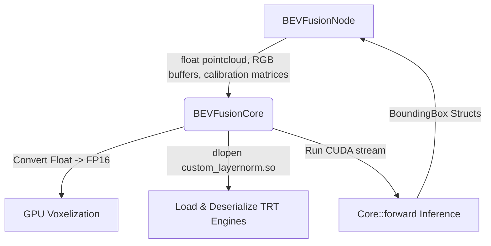

# How BEVFusion fits together
BEVFusion takes one image per camera in `camera_names` (6 today) and a LiDAR point cloud, runs the GPU-accelerated TensorRT model, and publishes 3D bounding boxes.

The package is split into these parts:
1. **`BEVFusionCore`**: Pure C++ & CUDA wrapper around the underlying NVIDIA/WATO engine. Knows nothing about ROS.
2. **`CameraMatcher`** (`camera_matcher.hpp`) and **`sweepTargets()`** (`lidar_sweep_timing.hpp`): header-only, ROS-free camera matching. They pick, for every LiDAR scan, one frame per camera.
3. **`BEVFusionNode`**: ROS 2 Lifecycle Node wrapper. Manages topics, parameters, camera matching, the inference worker thread, coordinate frames (TF2), and translates ROS messages to/from raw C++ structures.

---

## 1. `BEVFusionCore` (The C++/CUDA Engine Wrapper)
**Purpose:** Handles low-level GPU setup, data type conversion, and network inference.



* **`initialize()`**
  * **Purpose:** Loads the custom layer-normalization library via `dlopen`, auto-builds any missing TensorRT `.plan` engines from ONNX, configures model architecture parameters, deserializes the five `.plan` / `.onnx` files into GPU memory, and creates a CUDA stream.
  * **Why:** Deserializing the models takes a few seconds and allocates substantial GPU memory. By doing this once in a dedicated method, we can trigger it during the ROS `on_configure` state before any real data starts flowing.
  * **Key steps inside the function (as implemented in `bevfusion_core.cpp`):**

        1. `dlopen("libcustom_layernorm.so", RTLD_NOW)` — **Why:** The detection head uses a custom Layer Normalization layer not natively supported by vanilla TensorRT. Without loading this shared object first, the TRT engine deserializer will fail to parse `head.bbox.plan`.
        2. `checkModelFilesExist()` — verifies the four `.plan` engines (`camera.backbone`, `camera.vtransform`, `fuser`, `head.bbox`) and the `lidar.backbone.xyz.onnx` file are present in `build_dir` / `model_dir`. If any `.plan` is missing, `buildTRTEngines()` compiles it from the corresponding `.onnx` via `compileTrtModel()` (uses `nvinfer1::IBuilder` + `nvonnxparser::IParser`, writes the serialized engine to disk). This lets a fresh checkout build engines on first run instead of requiring them to be pre-baked into the model directory.
        3. Build configuration parameters (`NormalizationParameter`, `VoxelizationParameter`, `SCNParameter`, `GeometryParameter`, `TransBBoxParameter`) from the `BEVFusionInputConfig` struct (populated by the node from ROS parameters).
        4. *Note:* `interpolation` is the ROS parameter `interpolation` (`"bilinear"`, the default and the mode used in practice, or `"nearest"`).
        5. Call `bevfusion::create_core(param)` and store it in `pipeline_`.
        6. Create a dedicated CUDA stream so transfers and inference stay ordered without using the application's default stream.

* **`stream()`**
  * **Purpose:** Returns the CUDA stream the pipeline runs on. On the NITROS path the node takes each GPU image's read handle for this stream, so the camera's writes are ordered before the copy into the pipeline without blocking the CPU.
* **`updateCalibration(...)`**
  * **Purpose:** Updates the GPU geometry-mapping kernels with the `N x 4 x 4` camera extrinsics, intrinsics, and image augmentation/downscaling matrices.
  * **Why:** Since the camera positions on the vehicle are fixed, we only need to compute and upload these transformation matrices once at startup (or whenever camera calibrations update), rather than doing it on every frame.
* **`infer(...)`**
  * **Purpose:** Converts the input LiDAR point cloud from standard 32-bit float (`float`) to 16-bit half-precision (`nvtype::half`) as required by the GPU voxelization kernels, then runs the forward inference pass.
  * **Why:** ROS 2 provides standard float point clouds, but the high-performance CUDA implementation requires FP16 for speed. Keeping this conversion inside `infer` keeps it hidden from the ROS node.

---

## 2. Camera matching (`CameraMatcher`, `sweepTargets()`)
**Purpose:** For every LiDAR scan, choose the frame from each camera that best matches what the LiDAR saw.

* **Target time per camera.** A Velodyne scan is stamped with its last packet and its points are stored in firing order. `sweepTargets()` takes the azimuth of the last points (where the beam was at the stamp) and the rotation direction, and works out when the beam pointed along each camera's viewing direction: `target = stamp - angle(camera -> end, in the rotation direction) / 360 * period`. With `lidar_stamp_position: start` the stamp is the time of the first points, so it takes their azimuth and adds instead: `target = stamp + angle(start -> camera) / 360 * period`. The period is measured from the scan stamps by `RotationPeriodEstimator` (one scan is one turn: the median of the last 20 stamp steps, once 5 are known; a step back starts over, a step of 1 s or more is ignored), and `lidar_rotation_period_ms` is used until then. It uses stamps only, so it is the same live and at any bag playback rate. Each camera's direction is the azimuth of its optical axis in the LiDAR frame, from TF. A cloud that is not one ordered sweep returns no result, and the scan stamp is used for every camera instead: on 256 evenly spaced points the net rotation must be about one turn (300 to 420 deg), no step between neighbouring samples may exceed 90 deg, and the sample may never fall back more than 20 deg behind the furthest angle it reached (per-laser azimuth offsets make single steps go either way; recorded `lidar_cc` scans fall back at most 7 deg). This rejects half turns, merged clouds from several LiDARs and reordered points. Set `sync_target: scan_stamp` to always use the scan stamp. Because the driver's `cut_angle` is unset, the angle where a sweep starts and ends drifts from scan to scan; a camera within a few degrees of it can be given either pass (about 50 ms apart), and its image straddles the cut anyway.
* **Choosing a frame.** Each camera keeps its last `sync_frames_per_camera` frames, sorted by stamp. The frame nearest the camera's target is used, and a camera is decided as soon as that choice is certain (a camera's choice is final once made, so later frames or evictions never change it):
  * a frame stamped after the target has arrived (one camera's frames arrive in stamp order, so nothing later can be nearer), or
  * the newest frame before the target is so close that the camera's next frame cannot be nearer. The node bounds when the next frame can be stamped at the earliest: one frame interval after the newest frame, and one more interval after the frame before it than there are between the two (so a newest frame stamped late does not mislead it). The frame interval is the camera's shortest among its last 200 intervals (10 s at 20 Hz), less 10% for stamp jitter, and is only used once at least 20 intervals are known and a second one confirms it within 10%. The camera is decided when the newest frame is within `sync_early_fraction` of the time to that bound; with values up to `0.5` this only makes the decision sooner. Replaying both team bags' real stamps and arrival times, the early rule changed 0 of 64,158 camera picks and cut the mean decision time at the 60 ms cap from 56.6 to 43.1 ms (drive bag). It can still change a pick if two consecutive frames of a camera are stamped late, or if a camera ran at a lower rate (for example dropping every other frame) for its whole learning window and then speeds up.
* **Waiting.** If the choice is still not certain `sync_max_wait_ms` after the scan arrived (a frame is late or dropped), the newest frame before the target is used. The wait is in stream time: each scan's deadline is its arrival plus `sync_max_wait_ms / streamRate()`, where `streamRate()` is how fast scan stamps advance per unit of arrival time (the median of stamp step / arrival step over the last 20 scans, once 5 are known; exactly 1 when within 5% of it, so live matching is unchanged; clamped to 0.05 to 20 and kept across a reset). A bag played at 2× therefore waits 30 ms of wall-clock time for the same 60 ms of stamps, and gives the same picks as at 1×. A pause in playback is one outlier step and does not move the median. A scan with any chosen frame further than `sync_tolerance_ms` from its target is skipped. At most `sync_max_pending_scans` scans wait at once: beyond that the oldest is decided at once with the frames it has, as if its wait had run out. A stamp that jumps back more than 200 ms on any stream (a bag restarting) clears everything. Frames older than the kept ones are gone, so a scan that arrives far later than the frames around its targets can only use the oldest kept frame.
* All times are passed in (`now_ns`), so the same code runs in the node and in the unit tests. The matcher is not thread-safe; the node calls it under `matcher_mutex_`.

---

## 3. `BEVFusionNode` (the ROS 2 lifecycle wrapper)
**Purpose:** Bridges the C++ inference engine with the ROS 2 ecosystem.

### Main Lifecyle Hooks
* **`declareParameters()`**
  * **Purpose:** Declares all ROS 2 parameters (like model paths, camera input, LiDAR topic, and confidence thresholds) and instantiates the `BEVFusionCore` with default parameters. Rejects an unknown `camera_input` or `intrinsics_source`.
  * **Why:** Launch files and YAML can change the node configuration without a rebuild.
* **`on_configure()`**
  * **Purpose:** Retrieves the declared parameters, declares the QoS and camera matching parameters (`declareSyncParameters()`, which validates their ranges), builds the `BEVFusionInputConfig`, calls `core_->initialize()`, and sets up TF and diagnostics.
  * **Why:** This is where the node loads the model before execution starts.
* **`on_activate()`**
  * **Purpose:** Creates and activates the publishers, creates the `CameraMatcher` and starts the inference worker thread, then subscribes to each camera's images (both topics with `camera_input: auto`, plus a 1 s wall timer for `monitorInputs()`; one topic otherwise) and `camera_info`, and to the LiDAR. Computes calibration immediately if every camera's info is already cached.
  * **Why:** Subscriptions are created last, so the first callback finds the matcher and the worker ready.
* **`on_deactivate()` / `on_cleanup()` / `on_shutdown()`**
  * **Purpose:** Destroy the subscriptions and the deadline and input-monitor timers, release every frame the matcher holds (on the NITROS path these are GPU buffers of each camera's rectifier), join the worker thread, then deactivate or reset the publishers.

#### Inputs and matching
* **`compressedImageCallback(camera_idx, msg)`** (`camera_input: auto` or `compressed`)
  * Stores one camera's JPEG (`/<camera_name>/image_rect_compressed`) in the matcher. Nothing is decoded here. In `auto`, `acceptJpegFrame()` drops it while that camera has sent a NITROS image within the last second, and logs when the camera switches to JPEG.
* **`nitrosImageCallback(camera_idx, image_view)`** (`camera_input: auto` or `nitros`)
  * Stores one camera's GPU image (`/<camera_name>/image_rect`, from that camera's RectifyNode) in the matcher. Copying the NITROS message only keeps a reference to its GPU buffer. Images that are not `rgb8` are dropped. In `auto`, `noteNitrosFrame()` records the arrival, so the camera's JPEGs stand down, and logs when the camera switches to NITROS.
* **`monitorInputs()`** (`camera_input: auto`, every second)
  * After two checks in a row in which every camera sent a NITROS image within the last second (the car), drops the JPEG subscriptions and stops. They come back only when the node is re-activated.
* **`lidarCallback(lidar_msg)`**
  * Computes the per-camera targets (`scanTargets()`, see section 2) and adds the scan to the matcher. `scanTargets()` also updates the measured rotation period (warning once if it is more than 10% from `lidar_rotation_period_ms`) and, on live input only (scan stamp within 1 s of the node's clock), `checkLidarStampPosition()`: scans arrive about 0 after an end stamp and about one turn after a start stamp, so if the median of 20 scans says otherwise than `lidar_stamp_position`, it warns once.
* **`cameraInfoCallback(camera_idx, msg)`**
  * Caches each camera's `/<camera_name>/camera_info` and calls `computeCalibrationMatrices()` once every camera has reported. Skips work once `calibration_initialized_` is true, since intrinsics/extrinsics don't change at runtime.
* **`computeCalibrationMatrices()`**
  * **Purpose:** Queries TF2 for the camera-to-lidar transforms (extrinsics), takes the intrinsics from each cached `CameraInfo` (`K`, or `P` for rectified images, see `intrinsics_source`), computes the projection matrices, formats them into the `N x 4 x 4` layout expected by `BEVFusionCore`, and records each camera's azimuth in the LiDAR frame for the sweep targets.
  * **Why:** Resolving coordinate frame transforms (e.g., from `camera_front` to `base_link`) must be done through ROS's TF2 system.
* **`dispatchSets(sets)`, `armDeadlineTimer()`, `deadlineTimerCallback()`**
  * Every callback that adds to the matcher arms a one-shot wall timer for the matcher's next deadline, so a scan whose frames are late is decided on time without polling. Completed sets go to a single-slot mailbox: a newer set replaces one the worker has not started, and an older set never replaces a newer one. With debug logging on, each matched set is logged on one line (`[SYNC] set ...`).

#### Inference worker
* **`workerLoop()`** takes the newest set from the mailbox and calls `processSet()`. Inference runs on this thread, so slow inference never delays the subscription callbacks the matching depends on. Sets older than the last one processed are skipped, so detections are never published out of order.
* **`processSet(set)`**
  * A set can mix the two sources (`camera_input: auto`, while cameras switch over); CUDA-BEVFusion copies every image with `cudaMemcpyDefault`, so host and device pointers can be mixed in one call.
  * **NITROS frames:** checks each GPU image is `image_width x image_height` packed RGB8, takes a read handle for `core_->stream()` (the stream waits for the camera's write on the GPU) and passes the device pointers straight to `runInference()`. The handles are released after inference, which tells the camera's buffer pool the reads are done. CUDA-BEVFusion copies camera images with `cudaMemcpyDefault`, so device pointers are accepted.
  * **JPEG frames:** `decodeJpegImages()` decompresses the set's JPEG frames in parallel (`std::async` + `cv::imdecode`), converts BGR→RGB and validates/resizes them (`validateAndNormalizeImage()`), then calls `runInference()`.
* **`runInference(camera_images, lidar_msg, stamp, t_start, match_wait_ms)`**
  * **Steps:**

        1. Parses and trims the `PointCloud2` message into `x, y, z, intensity, time_lag` floats (`time_lag` is always `0`) (`processLidar()`, `validateAndTrimLidar()`).
        2. Executes TensorRT GPU inference (`core_->infer(...)`, under `core_mutex_` so calibration updates never overlap it).
        3. Converts output 3D bounding boxes into ROS `Detection3DArray` (`createDetections3D()`) and `MarkerArray` (`createMarkers()`) messages stamped with the **LiDAR scan's stamp**, transforming from `lidar_frame_id` to `target_frame`.
        4. Publishes detection topics, logs stage-by-stage profiler metrics (`[PROFILER]`, including how long the set waited for its frames), and updates diagnostic statistics.

    ### Detection filtering

      Filtering happens in two places. The TensorRT detection head removes boxes below `confidence_threshold` and boxes whose centers are outside `post_center_range_start` / `post_center_range_end`. After inference, `createDetections3D()` applies `ego_suppression_radius` in the LiDAR frame and drops boxes whose XY distance from the LiDAR origin is strictly less than that radius. Set the radius to `0.0` to disable this second filter.

# Other Helpful Notes

## How do we pass in the video feed?

**Frame by frame, one topic per camera.** On the car (NITROS images, chosen by the default `camera_input: auto`, or `nitros`), each camera's rectified image stays in GPU memory and the node passes its device pointer to `BEVFusionCore::infer()` without a copy through the CPU. From a bag (JPEGs, `auto` or `compressed`), the node decodes the JPEGs of the matched set and passes host pointers. Either way the pointers reach CUDA-BEVFusion `Core::forward()`, which copies them into its own buffer with `cudaMemcpyDefault`, so host and device pointers both work:

```cpp
std::vector<BoundingBox> forward(
    const unsigned char** camera_images,  // array of N pointers to packed RGB images, host or device
    const nvtype::half* lidar_points,     // host pointer to Nx5 half-float points
    int num_points,
    void* stream
);
```

## Which topics to publish detections to

**Two topics — implemented, node declares `output_detections`/`output_markers`, remapped in `perception.launch.yaml`:**

| Topic | Type | Purpose |
|---|---|---|
| `/perception/detections_3d_bev` | `vision_msgs/Detection3DArray` | 3D bounding boxes; kept on a separate topic from `spatial_association`'s output so both 2D→3D and BEVFusion→3D pipelines can run in parallel, with launch config choosing which one feeds `tracking` |
| `/perception/bev_detection_markers` | `visualization_msgs/MarkerArray` | Visualization → Foxglove |

**Why these specific topics:**
* Using a separate topic (rather than the topic `spatial_association` publishes `Detection3DArray` to) means both the 2D→spatial_association→3D and BEVFusion→3D pipelines can run in parallel, and which one feeds `tracking` is a launch-time remap decision rather than a code change.
* For Foxglove: `MarkerArray` is the standard. Foxglove's 3D panel natively renders `visualization_msgs/MarkerArray` as 3D cubes/wireframes. We create `Marker::CUBE` markers with the bounding box pose and dimensions. **This is the only thing we need for Foxglove visualization** — no custom panels required.

> TIP: Foxglove also supports `vision_msgs/Detection3DArray` directly in its 3D panel, but `MarkerArray` gives us more control over color, opacity, label text, and lifetime. Publish both.

---

## Converting `BoundingBox` → `Detection3DArray`

Each BoundingBox has:

```cpp
struct BoundingBox {
  Position position;  // x, y, z (in lidar frame)
  Size size;          // w, l, h
  Velocity velocity;  // vx, vy
  float z_rotation;   // yaw (radians)
  float score;        // confidence
  int id;             // class id (nuscenes: 0=car, 1=truck, ...)
};
```

`createDetections3D()` (`bevfusion_node.cpp`) maps to `vision_msgs::Detection3D` as implemented:
* BEVFusion outputs boxes in `lidar_frame_id`. A single `tf_buffer_->lookupTransform(target_frame_, lidar_frame_id_, stamp, timeout)` is done per callback and each pose is transformed to `target_frame` via `tf2::doTransform`.
* `detection.header.frame_id = target_frame_` (default `base_link`)
* `detection.bbox.center` — position from bbox, orientation from `tf2::Quaternion::setRPY(0, 0, -z_rotation)` (negated to convert BEV-map convention to ROS convention), both transformed to `target_frame`
* `detection.bbox.size.x = size.w`, `.y = size.l`, `.z = size.h`
* `detection.results[0].hypothesis.class_id = std::to_string(id)`
* `detection.results[0].hypothesis.score = score`

### Converting `BoundingBox` → `MarkerArray` (for Foxglove)

`createMarkers()` (`bevfusion_node.cpp`) creates one `visualization_msgs::Marker` per bbox, as implemented:
* `marker.type = Marker::CUBE`
* `marker.pose` = same position/orientation as the `Detection3D` center (already in `target_frame`)
* `marker.scale.x/y/z = size.w/l/h`
* Color by class via a `switch (class_id)` — all 10 nuScenes classes are mapped to distinct colors (see the class ID table below)
* `marker.color.a = 0.8`, `marker.lifetime = 1.0s` — boxes persist across frames and expire naturally; no DELETEALL is emitted to avoid flicker when BEVFusion runs slowly. TODO(ashish): replace with tracker-driven persistence once the tracker publishes predicted positions for lost tracks.
* `marker.ns = "bevfusion_detections"`, `marker.id` = index into the current frame's marker array
* `marker.header.frame_id = target_frame_`
* No DELETEALL is prepended; stale markers from the previous frame expire via their 1 s lifetime instead

Not yet implemented: `marker.text` labels (class name + score) for Foxglove hover tooltips — this is a possible follow-up.

---

## Calibration Matrix Computation

This is the hardest part unique to the codebase. CUDA-BEVFusion's `Core::update()` expects four flat matrices, each `N × 4 × 4` (num_cameras × 4 × 4):

| Matrix | What it is | Where we get it |
|---|---|---|
| `camera2lidar` | 4×4 transform from each camera frame to lidar frame | As implemented: `tf_buffer_->lookupTransform(lidar_frame_id_, camera_info.header.frame_id, tf2::TimePointZero)` directly (no inversion needed since we look up straight from lidar frame to camera frame). The camera's optical axis (third column) also gives its azimuth for the sweep targets. |
| `camera_intrinsics` | 3×3 camera matrix, padded to 4×4 | From each camera's `CameraInfo`: the left 3×3 of `p`, the camera matrix of the rectified images the node receives (`intrinsics_source: projection`, the default), or `k`, the raw distorted camera's (`intrinsics_source: camera_matrix`). Pad to 4×4 with identity bottom-right. |
| `lidar2image` | 4×4 projection from lidar to each camera's image plane | `lidar2image = camera_intrinsics @ extrinsic_lidar2camera`. Compute from the above two. |
| `img_aug_matrix` | 4×4 augmentation matrix (resize + crop applied to images) | Depends on the image preprocessing. For the standard BEVFusion resize (resize_lim=0.48 on a 900→256 image), this is a scale+translate matrix. If we feed full-resolution images (1600×900), compute it from the resize parameters. |

**`img_aug_matrix` — as implemented in `computeCalibrationMatrices()`:**

```cpp
int resized_w = image_width * resize_lim;
int resized_h = image_height * resize_lim;
int crop_x = (resized_w - norm_output_width) / 2;   // centered horizontal crop
int crop_y = resized_h - norm_output_height;        // bottom-aligned vertical crop
```

The resulting 4x4 matrix scales by `resize_lim` on the X/Y diagonal and translates by `-crop_x` / `-crop_y`. This is a simplified augmentation matrix (scale + translate only, no rotation/flip) — it's covered by `test_bevfusion_node.cpp`, which checks the nuScenes-default case (`1600x900`, `resize_lim=0.48` → `crop_x=32`, `crop_y=176`) against the upstream CUDA-BEVFusion example values.

> IMPORTANT: Getting the calibration matrices right is critical. Wrong matrices = detections in wrong positions. If you change `image_width`, `image_height`, `resize_lim`, or `norm_output_width/height`, re-verify against `test_bevfusion_node.cpp`'s `img_aug_matrix` test cases and, ideally, real detections on a known scene.

---

## CUDA info
1. **CUDA Streams**: `Core::forward()` takes a `cudaStream_t`. To create and destroy it, the node calls `cudaStreamCreateWithFlags(&stream_, cudaStreamNonBlocking)` and `cudaStreamDestroy(stream_)`. The `NonBlocking` flag prevents BEVFusion's GPU ops from implicitly synchronizing with the null (default) CUDA stream used by the rest of the application. These require `<cuda_runtime.h>` and linking against the CUDA runtime (`cudart`).
2. **FP16 Types**: The library expects LiDAR points as `nvtype::half*`. This is a wrapper around CUDA's `__half` type from `<cuda_fp16.h>`. the compiler needs the CUDA headers to use this type and the intrinsics for converting standard 32-bit `float` to 16-bit `half`.

## Config and Launch

### params.yaml
This is done — see `bevfusion/config/params.yaml` for the full set of defaults (camera input, topics, model directory, camera resolution, voxelization, BEV grid bounds, camera matching, and QoS). The vehicle-specific overrides live in `perception_bringup/config/perception_bringup.yaml` under `/**/bevfusion_node`; see the top-level [DEVELOPING.md](../DEVELOPING.md#parameters) parameter table for the full list.

### perception.launch.yaml

This is done. `bevfusion_node` is loaded as a composable node into `perception_container` in `perception_bringup/launch/perception.launch.yaml`, in the same process as the cameras so NITROS images are handed over without a copy. The launch file passes no `camera_input`, so the default `auto` uses NITROS on the car and JPEG from a bag, with no launch argument. The outputs are remapped:

```yaml
param:
  - from: $(var config_file)
remap:
  - from: output_detections
    to: /perception/detections_3d_bev
  - from: output_markers
    to: /perception/bev_detection_markers
```

Camera topics are built from `camera_names` (`/<camera_name>/image_rect`, `/<camera_name>/image_rect_compressed`, `/<camera_name>/camera_info`); the LiDAR topic is `input_lidar_topic`.

---

## Class ID Mapping (nuScenes)

The BoundingBox `id` field maps to nuScenes object classes:

| ID | Class |
|---|---|
| 0 | car |
| 1 | truck |
| 2 | construction_vehicle |
| 3 | bus |
| 4 | trailer |
| 5 | barrier |
| 6 | motorcycle |
| 7 | bicycle |
| 8 | pedestrian |
| 9 | traffic_cone |

Use these for setting `class_id` in Detection3D and marker colors.

The `createMarkers()` color mapping matches the nuScenes class table:

| ID | Class | Marker color |
|---|---|---|
| 0 | car | Green |
| 1 | truck | Blue |
| 2 | construction_vehicle | Orange |
| 3 | bus | Purple |
| 4 | trailer | Cyan |
| 5 | barrier | Yellow |
| 6 | motorcycle | Magenta |
| 7 | bicycle | Sky blue |
| 8 | pedestrian | Red |
| 9 | traffic_cone | Amber |
| other | — | White |

---

## Key Gotchas

1. **Image format**: CUDA-BEVFusion expects **RGB** `unsigned char*`. OpenCV decodes to **BGR**. We need `cv::cvtColor(img, img, cv::COLOR_BGR2RGB)`.

2. **Image resolution — resolved**: The model was trained on nuScenes' `1600×900 → 704×256` (resize_lim `0.48`). Eve's cameras are `1280×1024`, so `image_width`/`image_height` in `params.yaml` are set to `1280`/`1024`, and `resize_lim` is computed from them and the network input size (about `0.55`), to reproduce roughly the same crop geometry into the same `704×256` network input — see `NormalizationParameter` construction in `BEVFusionCore::initialize()` and the `img_aug_matrix` math above. If you retrain on Eve-resolution data, revisit both `NormalizationParameter` and the aug matrix together.

3. **LiDAR point format and iterators**: `processLidar()` uses `PointCloud2ConstIterator<float>` to extract `x, y, z, intensity` without manual byte math. The 5th feature is the nuScenes multi-sweep **time lag** (seconds since the current sweep), which is always `0` for a single sweep — it is **not** the Velodyne `ring` index. Feeding `ring` there puts values of 0–31 into a channel the model only saw in ~0–0.5, which corrupts the voxel features.

4. **Thread safety**: The CUDA-BEVFusion `Core` is **not thread-safe**. Inference runs only on the worker thread, and `core_mutex_` keeps calibration updates (from the camera info callback) from overlapping it. `CameraMatcher` is guarded by `matcher_mutex_`.

5. **`dlopen` for custom_layernorm**: Must be called before `create_core()`. Include `<dlfcn.h>` in `bevfusion_core.cpp`. If it fails silently, TRT will fail to deserialize the head.bbox engine. Always check the return value.

6. **Frame IDs — resolved**: BEVFusion outputs bounding boxes in `lidar_frame_id`. `createDetections3D()` now performs a `tf_buffer_->lookupTransform(target_frame_, lidar_frame_id_, stamp)` per callback and applies `tf2::doTransform` to each bounding box pose before stamping the output with `target_frame_` (default `base_link`). Output detections are correctly expressed in `target_frame`.

7. **First inference is slow**: TRT engine deserialization + warmup takes 5-15 seconds. Consider calling `core_->infer()` once with dummy data during `on_configure()` or `on_activate()` so the first real frame isn't delayed.

---

## Testing

```bash
colcon build --packages-up-to bevfusion --cmake-args -DBUILD_TESTING=ON
colcon test --packages-select bevfusion
colcon test-result --verbose
```

`test_camera_matcher` and `test_lidar_sweep_timing` cover the ROS-free matching (decision rules, waiting, tolerance, per-camera targets, payload release) and the sweep geometry on synthetic clouds. `test_bevfusion_node` covers parameters, the activated input path, the worker mailbox, sweep targets from a `PointCloud2`, and calibration.
